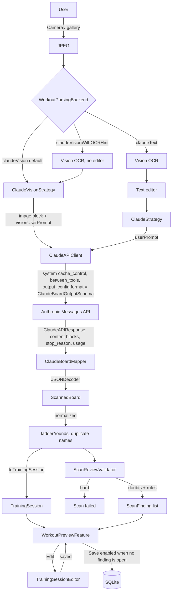

# Plan scan — flow (schema v2)

- Backend choice lives in `WorkoutParsingBackend` + `WorkoutParsingStrategyFactory`; the scan feature only knows the enum.
- `ScannedBoard` has no optionals: 0, "" and [] mean "not on the board"; enums are closed, so the API enforces them.
- `ExtractedWorkout` (schema v1) was removed in IOS-00161; the harness for it lives in `PLANS/scan-eval/legacy-v1/`.
